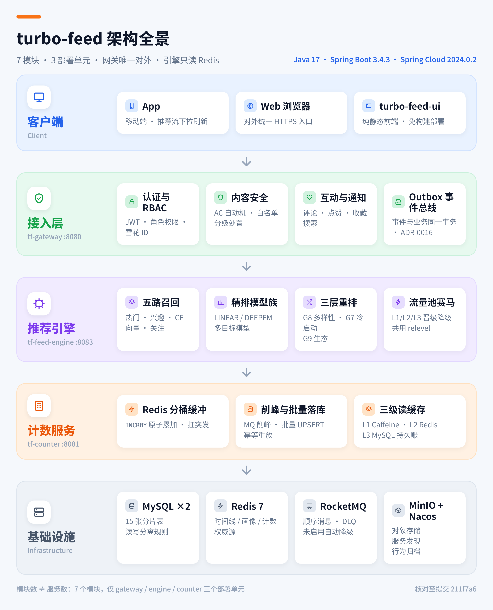
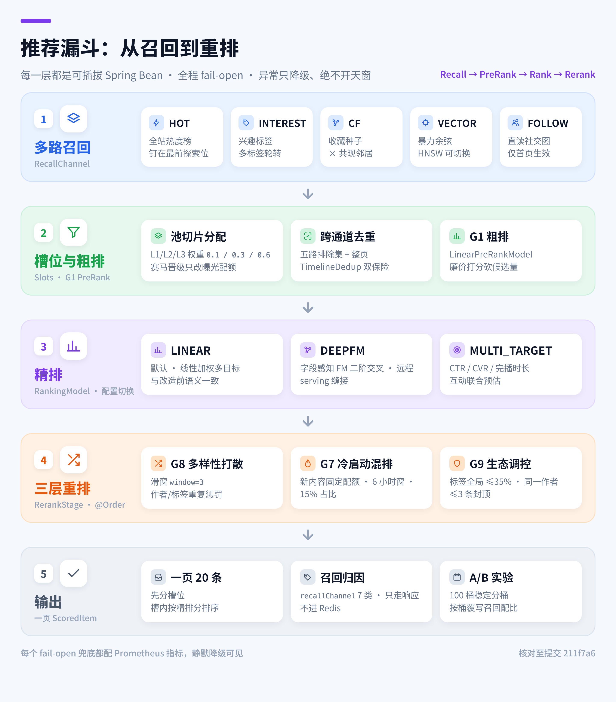
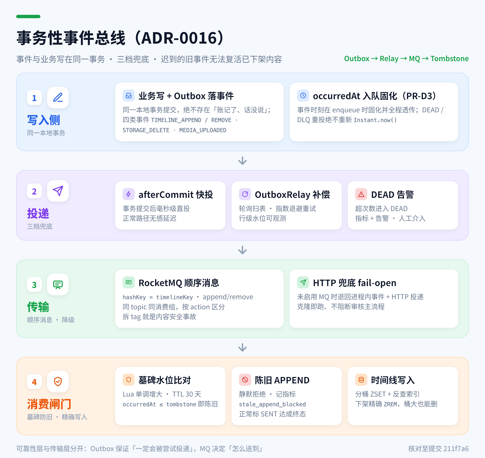
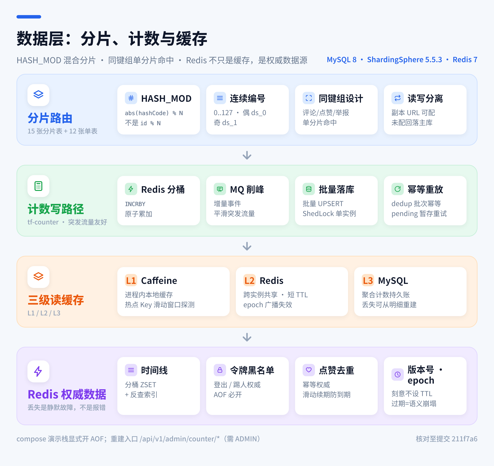

# turbo-feed

> **一个把「上线后才会暴雷」的问题提前写好答案的短视频 Feed 后端参考实现。**
> Java 17 / Spring Boot 3.4.3 多模块工程：抖音式推荐漏斗 · 事务性事件总线 · 分布式计数 · 内容安全词库 · 128 分片数据层。


---

## 为什么值得 Star

这不是又一个「跑通点赞接口」的 Demo。仓库里每个关键取舍都附了实测数据与代码注释，
而且**不假装没做完的东西已经做完了**——未接通的动作会显式标注当前等价行为。
几个只有真上过生产才会问的问题，这里都有答案：

- 推荐页怎么做到**只读 Redis、不碰数据库**，还能精确下架任意一条内容？—— 写时物化 ZSET 时间线 + 反查索引 + 作者索引 + **Lua 单调墓碑**，一条迟到的 MQ 旧消息也无法把已下架内容「复活」。
- MQ 挂了 Feed 断流？—— **Outbox 同事务落事件** + afterCommit 快投 + Relay 退避补偿 + DEAD 告警；未启用 MQ 时自动降级进程内投递，克隆即跑。
- 推荐排序想换模型，要改多少代码？—— 一个配置项。精排做成**可插拔模型族**（LINEAR / DEEPFM / MULTI_TARGET），五路召回、三层重排都是 Spring Bean，加一路不用动主编排。
- 一个服务挂了，整页推荐开天窗？—— **全链路 fail-open 有明确分界线**：主数据写入 strict 抛异常进 DLQ，一切增强信号（画像/召回/重排/缓存）静默降级且**每处都有 Prometheus 指标**。
- 敏感词库热更新会不会卡住线上请求？—— `AtomicReference` 整快照 CAS 切换，**读路径零锁**；AC 自动机一次扫描收集全部命中，逐命中查白名单后按严重度取最严重动作。
- 128 分片下点赞计数扛得住突发流量吗？—— 独立计数服务：Redis 分桶缓冲原子累加 → MQ 削峰 → 批量 UPSERT，读侧 L1 Caffeine / L2 Redis / L3 DB 三级缓存。

## 模块结构（按真实代码统计）

```
turbo-feed/
├── tf-gateway/      :8080  接入层（42.8k 行）：认证/RBAC · 媒体上传(一帖多图) · 审核状态机 · 内容安全 · 评论/点赞/收藏 · 通知中心 · 搜索 · Sentinel
├── tf-feed-engine/  :8083  Feed 引擎（17.0k 行）：推荐漏斗(五路召回/粗排/精排/三层重排) + 三级流量池赛马 + 多池 ZSET 时间线 + 墓碑防旧 + 实验分桶
├── tf-counter/      :8081  计数服务（2.2k 行）：Redis 分桶 + MQ 削峰 + 批量落库 + 三级读缓存 + ShedLock 多副本
├── tf-shared/              契约库（2.6k 行）：跨服务传输模型 + Redis Key 门面 + 开关常量 + 契约版本协商，零第三方依赖
├── tf-redis/               Redis 接入单一事实源：single / sentinel / cluster 拓扑装配，三个服务引入即生效
├── tf-hotspot/             热点治理 SDK：L1 本地缓存 + Redis pub/sub 失效广播（按「脏窗口代价」逐键决定是否广播）
├── tf-benchmark/           压测套件（1.8k 行）：LoadRunner + 场景注册表 + CI 退出码 + Markdown 报告
└── turbo-feed-ui/          纯静态前端（无构建）：登录 / 发布 / 公域 Feed / 审核工作台
```

> 行数为各模块 `.java` 实测（含测试代码），随迭代增长；571 个 Java 文件、约 67k 行。

服务间：同步走 HTTP（对外 `/api/v1/**` 与内部 `/internal/**` 物理隔离，`X-Internal-Token` 双侧校验，非 dev/local 缺令牌启动即失败）；
异步走 RocketMQ **顺序消息**——时间线 `append`/`remove` 同 topic 同消费组靠 `action` 区分，保证「已下架内容不会复活」。未启用 MQ 时自动退回进程内事件 + HTTP 投递。

### 架构全景



## 技术栈

Java 17 · Spring Boot 3.4.3 · Spring Cloud 2024.0.2 + Alibaba 2023.0.3.4（Sentinel 流控、Nacos opt-in 服务发现）· Maven 多模块 ·
MySQL 8 + ShardingSphere 5.5.3（**16 张分片逻辑表**：7×hashMod4 + 9×hashMod128，另 12 张显式登记单表，读写分离规则已配）· Redis 7（Lettuce，时间线/画像/计数权威源）·
RocketMQ（starter 2.3.5 / client 5.3.2，顺序消息 + DLQ）· Canal 1.1.7（outbox CDC opt-in）· MinIO 8.5.7（对象存储 + 行为日志归档）· Redisson 3.27.2 / Caffeine · ArchUnit 1.3.0

---

## 亮点一：抖音式推荐漏斗（召回 → 粗排 → 精排 → 三层重排）

位于 `tf-feed-engine`，`RecommendationPipeline` 只负责编排顺序、门控、跨通道去重与池切片分配；
每一层都组件化、可插拔，且**全程 fail-open**——任一层异常都退化为「不生效」，绝不让推荐页开天窗。



围绕漏斗的配套能力：

- **三级流量池赛马**：新内容先进 L1 小池试水，按互动率晋级 L2/L3、按差评率降级；晋级/降级**共用同一份 `relevel` 实现**，只改池号绝不动入流时刻（keyset 游标与赛马语义都依赖这条不变量）。
- **写时物化 + 墓碑防旧**：内容过审即写 Redis 四件套（分桶 ZSET / 反查索引 / 作者索引 / 标签倒排），读路径单请求上界「3 天 × 3 池 × 每桶 500 条」；下架写 Lua 单调墓碑，**DEAD/DLQ 重投的迟到 APPEND 比对水位后静默拒绝**。
- **页缓存两段式失效**：匿名 15s / 登录 5s TTL 只是兜底，主路径靠 `INCR tf:feed:rec:version` 让所有旧页 Key 立即不可达；登录 Key 强制带 `u:{userId}`（曾真实发生过串号事故）。
- **keyset 游标深翻页**：`depth:score:timelineKey` 编码，跨页严格单调不重复；续拉页刻意关闭五路个性化召回（门控写在 `slotsFor()` 里，不是漏接线）。
- **审核与推荐解耦**：`ReviewSignalClient` 直读 `tf:mod:` KV，召回层过滤 INTERCEPT/MONITOR 内容与低健康分作者，排序层懒读降权——不阻塞、不耦合。
- **A/B 尺子**：`ExperimentBucket` 把 userId 稳定映射 100 桶，可对某一桶覆写召回配比做对照实验。
- **训练闭环**：行为事件（含 `requestId`/`position`，专为负样本判定与 position bias 校正留的字段）落本地 JSONL → gzip 归档 MinIO → 离线训练向量回灌 Redis。
- **关注流大 V 治理**：关注流本来就是读扩散（写作者索引、读关注列表），缺口不是「推不动大 V」而是热 key 与扫描窗口截断。现已落地大 V 优先扫描 + 动态 per-author 配额、作者索引分片副本、viewer hash 读分片与 5s 本地 L1 缓存；默认保持旧行为，按配置 opt-in 灰度。

> 诚实标注：DEEPFM 当前是本地确定性 FM 实现（交叉项默认权重很小，权重为 0 时 ≡ 线性模型），真实远程 serving 走 `RankModelClient` 缝接，尚未接入训练好的线上模型；MULTI_TARGET 同理。

## 亮点二：事务性事件总线与可靠性（ADR-0016）

发件箱不是贴个表就完事，这里把它做成了**有严格语义保证的事件总线**：

- **Outbox 同事务落事件**：`TIMELINE_APPEND/REMOVE`、`STORAGE_DELETE`、`MEDIA_UPLOADED` 四类事件与业务写在同一本地事务，绝不存在「账记了、话没说」；`afterCommit` 快投 + Relay 退避补偿 + DEAD 告警三档兜底。
- **事件时刻固化（PR-D3）**：payload 在 enqueue 时刻固化 `occurredAt` 并全程透传，DEAD 行/DLQ 重投绝不重新 `Instant.now()`——否则迟到的 APPEND 会绕过墓碑水位，已下架内容被复活。
- **顺序消息的正确姿势**：时间线 append/remove 共用 topic 与消费组、按 `timelineKey` 做 hashKey——按 action 拆 tag 是内容安全事故，不是风格问题。
- **事务边界收口**：上传/落库外层壳不整体加 `@Transactional`（同类自调用代理失效 + 外部 IO 拉长事务），改用 `TransactionTemplate` 把「写库 + 落事件 + afterCommit 投递」收进同一个短事务。
- **严格删除**：`deleteOrThrow` 把 not-found 当成功（幂等），真失败留行重试，不静默吞掉。



配套：**契约版本协商**（`ContractVersion`：缺版本容忍、高版本抛异常，发布顺序「先消费者后生产者」）、**FeatureFlagGuard 启动期组合校验**（非法开关组合 fail-fast）、**雪花 workerId 租约**（多实例不撞号）。

**规模化演进（已实现、默认 opt-in）**：`outbox_event` 已由单表切成 **128 分片**，分片键选雪花 `id`（不是 `aggregate_id`），让 `findById/claim/markSent/markFailed/reDeadLetter` 全部单分片命中；`OutboxSentCleaner` 先清 SENT 终态冷行，控制广播扫描体积。CDC 旁路为 `MySQL binlog → Canal → CanalCdcForwarder → RocketMQ turbofeed-outbox-cdc → OutboxCdcConsumer → tryDeliver`，消息只带 `eventId + traceId`，payload 仍以 DB 行为唯一事实源；幂等靠 `claim` CAS，不靠 MQ 去重。Canal Server、转发器、Topic 与端到端链路已在本机真启动验证，生产灰度见 [outbox-cdc-rollout.md](docs/ops/outbox-cdc-rollout.md)；分片迁移与路由实证见 [outbox-sharding-rollout.md](docs/ops/outbox-sharding-rollout.md)。CDC 默认关闭，Relay 永不关。

## 亮点三：教科书级的内容安全模块

位于 `tf-gateway/.../service/moderation/`，四层解耦：

```
写路径 requireClean(scene, text, userId)
  → ① 长度校验（按场景：昵称/描述/评论）
  → ② TextNormalizer 归一化（抗绕过主战场）
  → ③ AhoCorasick 一次扫描收集全部命中
  → ④ 逐命中白名单豁免 → 按分类取最严重动作
  → ⑤ LongAdder 分场景计数（命中/豁免/各动作）
```

- **Aho-Corasick 多模匹配**：一次扫描命中全词库 O(n+m+z)，注释附 1k/10k/200k/1M 词条实测吞吐与内存曲线。
- **热更新零锁读**：`(COUNT, MAX(updated_at))` 30s 指纹检测 + admin 增删即时 reload；异常保留旧快照（旧词库总比空词库好）。
- **抗绕过归一化流水线**：逐字符 NFKC → 剥零宽/方向标记/BOM/软连字符 → 剥分隔符 → 小写 → 繁→简折叠；同步维护「归一化下标→原文下标」映射用于前端高亮。
- **分类决策而非二值**：动作分 `PASS / LIMIT / REVIEW / BLOCK` 显式带 `severity()` 定级。
  > 诚实标注：当前 `REVIEW` 等价 `BLOCK`、`LIMIT` 等价 `PASS`，尚未接通人审队列与 feed 降权标记。
- **防猜词库**：拒绝时不回显命中词；**启动自检**校验繁简映射编码与方向，把「手滑错位导致整张表静默失效」挡在部署前。

## 亮点四：数据层与分布式计数

- **16 张分片逻辑表 + 12 张单表**：`HASH_MOD`（`abs(hashCode) % N`，不是 `id % N`）混合分片；同键组设计让「某内容下所有评论/点赞/举报」单分片命中；`outbox_event` 按雪花 `id` 分片，避免投递主链路 CAS 广播。读写分离规则已配好，副本 URL 由 compose 参数化注入（未配则回落主库，读路径照常可用）。
- **计数服务独立部署**：Redis 分桶缓冲原子 `INCRBY` → MQ 削峰 → 批量 UPSERT；`counter_flush_dedup` 批次幂等 + `counter_flush_pending` 失败暂存重放；prod 切共享 MySQL + ShedLock 抢锁，多副本不再各持一份 H2。
- **三级读缓存**：L1 Caffeine → L2 Redis → L3 DB；热点 Key 滑动窗口探测（`tf-hotspot`）。
- **可观测性闭环**：全链路失败模式台账（`docs/architecture/failure-mode-ledger.md`）、Outbox 水位指标、墓碑拦截指标、召回/排序/重排逐层 `tf_feed_*` Prometheus 指标——**每个 fail-open 兜底都必须埋点**是仓库的硬规矩。



---

## 快速开始

```bash
# 依赖：MySQL(:3306) / Redis(:6379) / MinIO(:9000，bucket turbo-feed-media 需匿名可读)
# 建表 + 演示账号：deploy/mysql/init-local.sql（既有库升级：deploy/mysql/migrate_post_group.sql 等）
cp .env.example .env                       # 填 JWT_SECRET / 内部令牌 / DB / MinIO 凭据

mvn clean package
java -jar tf-gateway/target/tf-gateway-*.jar          # :8080 接入层
java -jar tf-counter/target/tf-counter-*.jar          # :8081 计数
java -jar tf-feed-engine/target/tf-feed-engine-*.jar  # :8083 Feed 引擎
```

> 本地在 APFS 加密卷（如 macOS 挂载的 D 盘）构建时，`mvn package` 的 repackage 阶段可能因 mmap 重命名失败；加 `-Plocal` 跳过 repackage 即可：`mvn -Plocal clean package`。

> **容器化一键起（推荐）**：参数化 `Dockerfile`（多阶段构建，按 `build.args.MODULE` 选子模块）+ `docker-compose.yml`（全栈：mysql + redis + minio + 三服务，RocketMQ 收进 `mq` profile）；`deploy/compose/docker-compose.prod.yml` 为自包含生产形态（端口收敛、健康检查、资源上限、AOF）。
> ```bash
> docker compose up -d                 # 不含 MQ（应用默认 mq.enabled=false）
> docker compose --profile mq up -d    # 额外拉起 RocketMQ
> ```

压测示例（退出码 0 = 成功率 ≥99%，可作 CI 性能门禁）：

```bash
java -cp tf-benchmark/target/classes:<deps> com.turbofeed.benchmark.BenchmarkMain \
  --base-url http://127.0.0.1:8080 --scenario feed \
  --concurrency 32 --duration 60s --warmup 10s \
  --phone 13800138000 --password 123456
```

### 环境变量（部分刻意无默认值，缺失即启动失败）

完整清单见 `.env.example` 与 `docker-compose.yml`：

| 变量 | 说明 |
|---|---|
| `TURBOFEED_SNOWFLAKE_WORKER_ID` / `_DATACENTER_ID` | 雪花实例标识（0~31），单实例也必须显式给，多实例必须逐实例不同 |
| `TURBOFEED_JWT_SECRET` | **JWT 签发密钥（必填 ≥32 位）**；缺失则网关启动失败 |
| `TURBOFEED_INTERNAL_TOKEN` | 服务间 `/internal/**` 共享令牌；仅 `dev`/`local` 允许缺失，其它 profile 缺失即启动失败 |
| `TURBOFEED_REDIS_PASSWORD` / `TURBOFEED_REDIS_MODE` | Redis 口令与模式（single / sentinel / cluster） |
| `TURBOFEED_DB_USERNAME` / `TURBOFEED_DB_PASSWORD` | MySQL 账号密码（经 ShardingSphere 逻辑库数据源注入） |
| `TURBOFEED_MINIO_ENDPOINT` / `ACCESS_KEY` / `SECRET_KEY` | 对象存储地址与凭据 |
| `TURBOFEED_MQ_ENABLED` | 是否启用 RocketMQ 投递（默认 false，克隆即跑） |
| `TURBOFEED_OUTBOX_CDC_CONSUMER_ENABLED` / `_FORWARDER_ENABLED` | outbox CDC 消费端 / Canal 转发器开关，默认 false；转发器只应开一个实例 |
| `TURBOFEED_OUTBOX_CDC_TOPIC` / `_CONSUMER_GROUP` / `_CANAL_HOST` / `_CANAL_PORT` / `_CANAL_DESTINATION` | CDC Topic、消费组与 Canal 连接参数，默认值见 `application.yml` |
| `TURBOFEED_FEED_FOLLOW_BIGV_FIRST_ENABLED` / `_AUTHOR_INDEX_SHARDS` / `_AUTHOR_CACHE_ENABLED` | 关注流大 V 治理：优先扫描、作者索引分片数、L1 缓存；默认保持旧行为或 1 分片 |

常用开关：`--spring.profiles.active=mq` 启用 MQ 投递 · `turbofeed.media.storage=minio|local` ·
`turbofeed.feed.degraded-mode=empty|local-scan` · `turbofeed.review.moderation-mode=rule|pass|ai`。
**所有开关集中在 `FeatureFlagKeys`（30 个），`FeatureFlagGuard` 启动期做组合约束校验**——非法组合 fail-fast，不会「跑三天才发现数据不对」。

### Redis 持久化与灾备重建

Redis 在本项目**不只是缓存**，而是多项能力的权威数据源：

| Redis 中的数据 | 角色 | 丢失后的表现 |
|---|---|---|
| 令牌黑名单 `turbofeed:jwt:blacklist:{jti}` | 登出 / 风控踢人的权威 | 已吊销令牌重新可用，且**无任何报错** |
| 计数 Key `tf:like:count:*` | 点赞权威计数源 | 计数归零后从 1 重新累加 |
| 去重集合 `tf:like:users:*` | 幂等权威 | 老内容可被重复点赞 |
| 时间线 `tf:feed:tl:*` / 反查索引 `tf:feed:idx:*` | 公域读模型 | 推荐流空白（需走补投/重建） |
| 版本号 `tf:feed:rec:version` / `tf:mod:*:epoch` | 缓存失效水位 | 旧缓存重新可达（**刻意不设 TTL**） |

对应措施：compose 演示栈显式开启 AOF 并挂数据卷；`/api/v1/admin/counter/*` 提供 recount/rebuild 重建入口（需 ADMIN）；去重集合滑动续期避免固定 TTL 到期丢失幂等。

---

## 技术文档

完整文档树见 [`docs/`](docs/README.md)（与代码同仓，单一来源，CI 检查模块文档同步）：

| 入口 | 内容 |
|---|---|
| [docs/architecture/c4-model.md](docs/architecture/c4-model.md) | C4 架构模型：上下文 / 容器 / 组件三层 |
| [docs/adr/](docs/adr/README.md) | **17 篇架构决策记录**（0001~0016 + 实施计划），每份写清代价与否决过的方案；0016 为分布式事务重构合并版 |
| [docs/architecture/failure-mode-ledger.md](docs/architecture/failure-mode-ledger.md) | 全链路失败模式对账：投递语义 / 降级口径 / 指标与告警 |
| [docs/ops/](docs/ops/) | 运维手册：时间线墓碑、Outbox 水位、发件箱分片/CDC 灰度、多节点开关、评论读扩展、内容安全 SLO 等 13 篇 |
| [docs/modules/](docs/modules/) | 模块级技术文档（与 Maven 模块一一对应） |
| [docs/ops/deployment.md](docs/ops/deployment.md) | 构建部署 / 环境开关 / 生产前必改清单 |
| [CONTRIBUTING.md](CONTRIBUTING.md) | 贡献指南：环境 / 构建 / 提交规范 / 提交前自检清单 |

---

## 适合谁

- 想看清「一个真实 Feed 后端从 0 到 1 长什么样」的 Java 后端；
- 准备做推荐系统 / 分布式事务 / 内容安全 / 分布式计数 / 分库分表，需要一份**可跑、带压测、带失败模式台账**的参考实现；
- 喜欢「代码里写满为什么这么写」的工程师——这里没有伪装完成的烂尾，只有带数据的取舍、实测过的坑，和明确标注的待办。

---

## License

以仓库内声明为准。欢迎 Star ⭐，Issue 与 PR 都欢迎。
