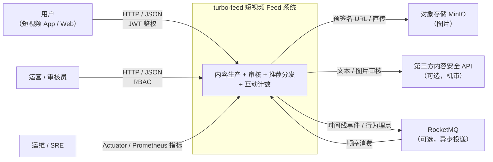
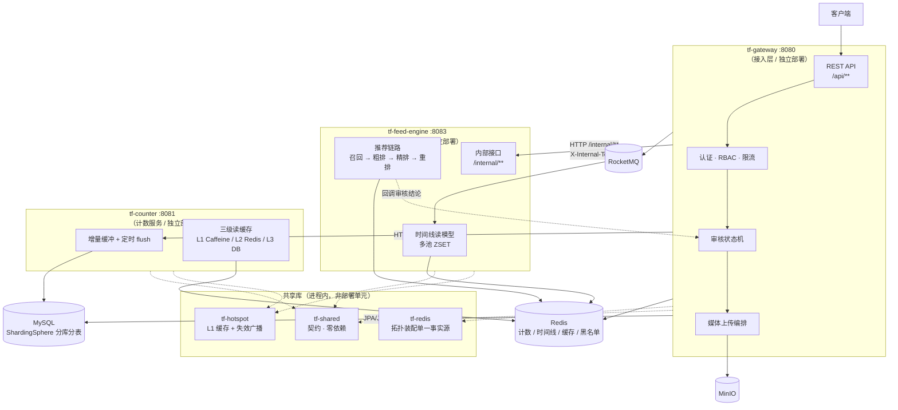
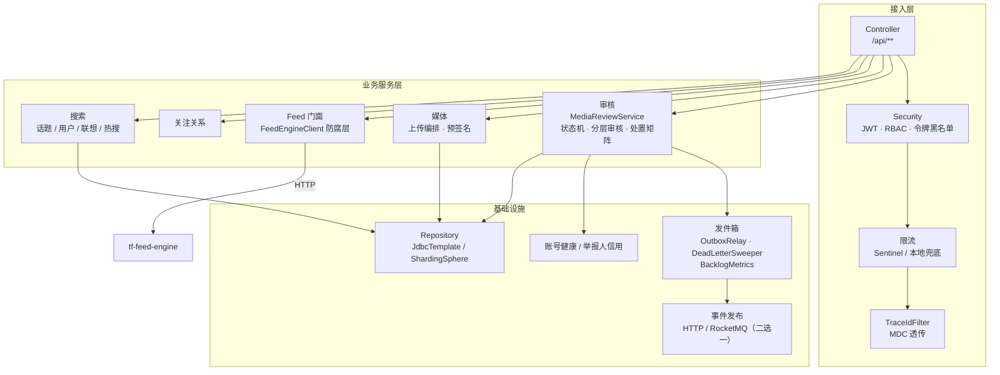
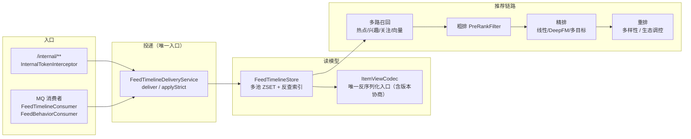
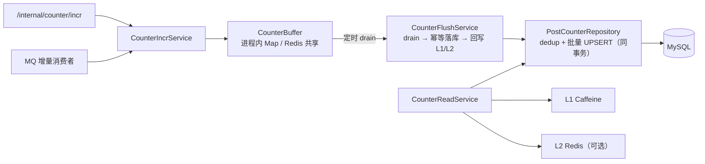

# C4 架构模型

> 用 [C4 模型](https://c4model.com/) 的四层视角描述本系统：**上下文 → 容器 → 组件 → 代码**。
> 层级越高越稳定（L1 一年可能都不变），越低越易变（L4 建议直接读代码）。
> 本文件覆盖 L1~L3；L4 不写——代码是最好的 L4，抄一遍只会变成第二份会漂移的真值。

图用 Mermaid 绘制（GitHub / IntelliJ 均原生渲染）。若你的环境不渲染图，
每张图下面都有等价的**表格描述**，信息不丢。

---

## L1 系统上下文（System Context）

谁在用这个系统、它依赖谁。

| 外部角色 | 交互方式 | 说明 |
|---|---|---|
| 终端用户 | HTTP + JWT | 注册登录、上传、发布、浏览 Feed、点赞评论关注 |
| 运营 / 审核员 | HTTP + RBAC | 审核队列、处罚、搜索索引重建、灾备重建 |
| 运维 | Actuator / 指标 | 健康探活、`/actuator/prometheus` 指标 |
| MinIO | S3 协议 | 媒体存储；上传走**预签名直传**，应用不中转字节 |
| 第三方内容安全 API | HTTPS | 机审；默认关闭（`moderation-mode=rule`），开启后 fail-open |
| RocketMQ | 顺序消息 | 时间线投递 / 计数增量 / 行为埋点；默认关闭，关闭时退回 HTTP 或进程内 |

**关键约束**：MinIO / RocketMQ / 第三方审核**全部是可选依赖**。关掉它们系统仍能完整运行
（分别是本地存储、HTTP 直投、规则审核）。这是「克隆即跑」这条产品级要求的来源。

---

## L2 容器视图（Container）

三个可独立部署的服务 + 三个共享库。

| 容器 | 端口 | 职责 | 不负责什么 |
|---|---|---|---|
| `tf-gateway` | 8080 | 认证 / RBAC / 限流、媒体上传编排、**审核状态机**、关注关系、管理端 | 不持有 Feed 读模型（已拆到引擎） |
| `tf-feed-engine` | 8083 | 公域时间线读模型、推荐链路（召回/粗排/精排/重排）、行为埋点消费 | 不做鉴权、不写业务主数据 |
| `tf-counter` | 8081 | 计数增量缓冲与落库、三级读缓存 | 不承接实时热门内容读（那是网关） |
| `tf-shared` | — | 跨服务契约（`FeedItemView` / `FeedTimelineEvent` / `Result` …） | 零第三方依赖，不写逻辑 |
| `tf-redis` | — | Redis 拓扑装配（single/sentinel/cluster）+ 连接池 | 不提供业务语义 |
| `tf-hotspot` | — | 进程内 L1 缓存 + 失效广播 | 不是独立服务，以 jar 内嵌 |

**为什么引擎不做鉴权**：`/internal/**` 只允许内网访问 + `X-Internal-Token` 共享令牌，
鉴权在网关一次做完。引擎再做一遍等于两处真值，且引擎的调用方只有网关。

**为什么热点治理是库不是服务**：一次缓存查询加一次网络跳转，比本地 L1 命中慢一个数量级；
把它做成服务等于把「省下的那次查询」又还回去。用 pub/sub 广播失效解决多实例一致性。

---

## L3 组件视图（Component）

### L3.1 网关内部

| 组件 | 关键类 | 一句话职责 |
|---|---|---|
| 审核 | `MediaReviewService` / `MediaStatusMachine` / `DispositionPolicy` | 状态流转唯一入口；三档分层审核；违规→梯度处置 |
| 媒体 | `MediaUploadService` / `MediaUploadFinalizer` | 预签名直传 + 落库校验 + 孤儿回收 |
| Feed 门面 | `FeedEngineClient` | 网关与引擎之间的**防腐层**：引擎故障不上抛，返回 `Optional.empty()` |
| 发件箱 | `OutboxService` / `OutboxRelay` / `OutboxDeadLetterSweeper` | 本地事务 + 至少一次投递，把「消息丢失」变成「可能重复」 |
| 搜索 | `SearchController` + 索引重建任务 | 话题/用户/联想/热搜，Redis 为在线索引、DB 为重建来源 |
| 账号健康 | `AccountHealthService` / `AccountCreditService` | 违规累积→健康分→梯度限制 |

### L3.2 引擎内部

| 组件 | 关键类 | 一句话职责 |
|---|---|---|
| 投递 | `FeedTimelineDeliveryService` | **双通道唯一入口**：HTTP 与 MQ 的副作用集合由同一段代码保证 |
| 读模型 | `FeedTimelineStore` | 分池 ZSET + `tf:feed:idx:` 反查索引（精确 ZREM，杜绝桶内扫描） |
| 契约解析 | `ItemViewCodec` | 唯一反序列化入口（ArchUnit 门禁兜底），版本不兼容即跳过该条 |
| 推荐 | `RecommendationPipeline` | 召回→粗排→精排→重排，全程 fail-open |

### L3.3 计数服务内部

| 组件 | 关键类 | 一句话职责 |
|---|---|---|
| 增量入口 | `CounterIncrService` | MQ 与 HTTP 双入口，同一套累加逻辑 |
| 缓冲 | `CounterBuffer`（两实现） | standalone 用进程内 Map，集群用共享 Redis + ShedLock 选主 |
| 落库 | `CounterFlushService` / `PostCounterRepository` | 去重登记与批量 UPSERT **同事务**；去重命中可观测 |
| 读 | `CounterReadService` | L1 → L2 → L3 逐层回写；L2 默认关（零回归） |

---

## 读图须知：三条容易误解的线

1. **网关 → 引擎是同步 HTTP，网关 → 计数是 HTTP 或 MQ（二选一）**。
   时间线投递在开 MQ 后走 MQ，但**审核结论回写**始终走 HTTP（低延迟优先）。
2. **`tf-hotspot` 出现在两个服务的图里，但它不是部署单元**——它是被 gateway 与 counter
   内嵌的 jar。看部署拓扑时不要把它当成第四个进程。
3. **数据库只有一个 ShardingSphere 逻辑库**（两个物理库 `turbo_feed_1/2`），
   网关与计数服务共用；引擎**不直连 MySQL**，只读写 Redis 读模型。

## 维护规则

- **L1 变了**（新增外部系统 / 新增外部角色）→ 必须更新本文件 + `service-split.md`；
- **L2 变了**（新增服务 / 端口 / 通信方式）→ 必须更新本文件 + `docs/README.md` 目录树；
- **L3 变了**（组件职责边界变化）→ 更新对应 `docs/modules/*.md` 即可，本图只在
  组件增删时同步；
- 新增异步链路时，同时更新 [`failure-mode-ledger.md`](failure-mode-ledger.md) §2 的总览表。
