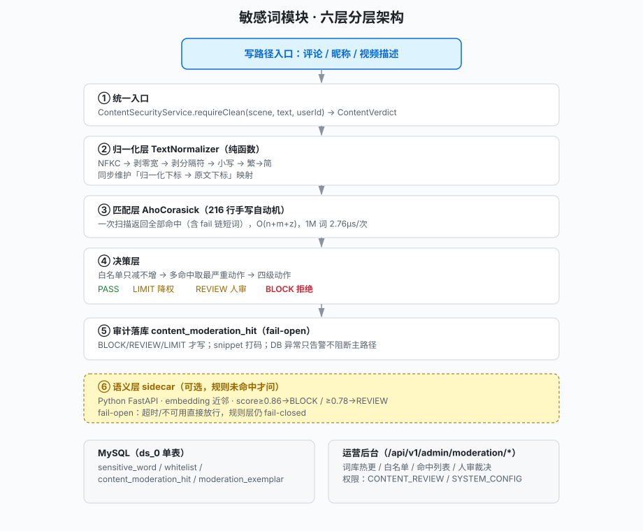
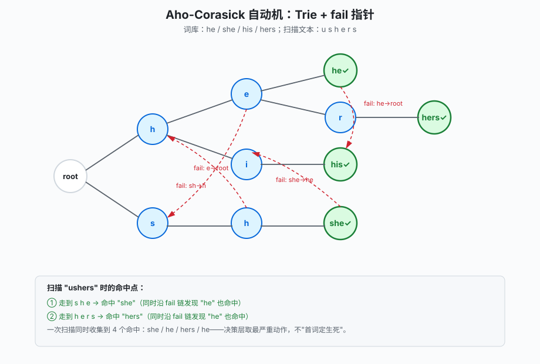
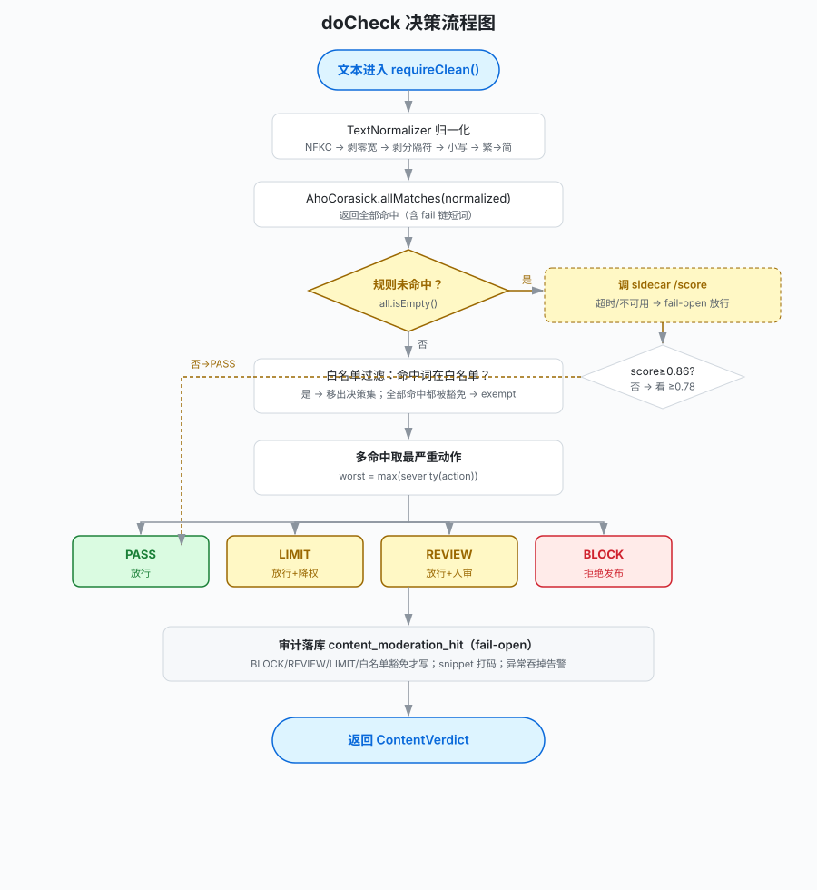
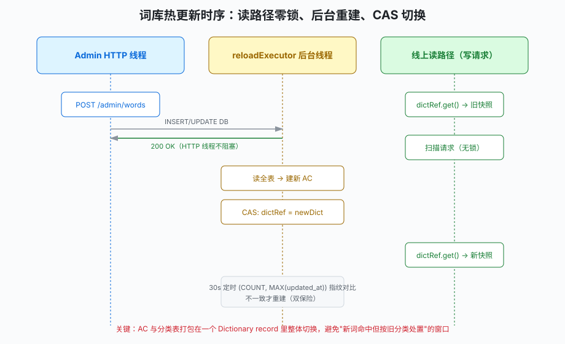
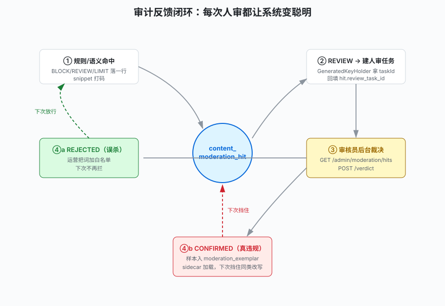
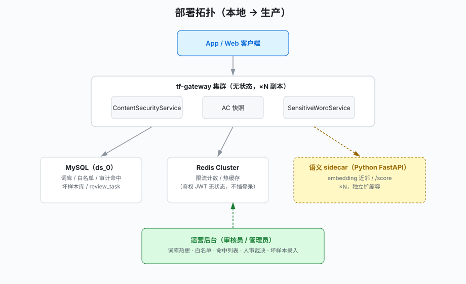
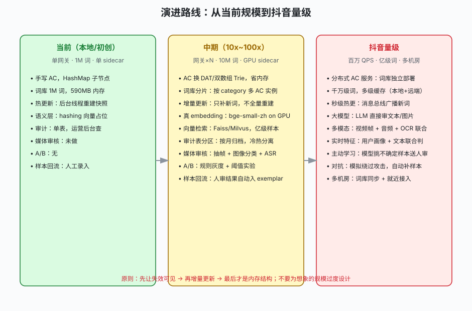

# 我用 3200 行 Java 把敏感词做成了 "工业级"—— 从字典匹配到审计闭环

> 这是一个真实项目（turbo-feed，Java 17 + Spring Boot 3.4 短视频 Feed）的内容安全模块拆解。全文约 8000 字，每一个论断都对应真实代码，数字来自实测。


***

## 一、先泼一盆冷水：`words.anyMatch(text::contains)` 不是内容安全

很多人第一次写敏感词，是这样的：


```
if (BAD_WORDS.stream().anyMatch(text::contains)) {
    throw new BizException("违规");
}
```

这段代码在 demo 里能跑，但一上生产就会被运营和用户一起骂：


* **绕过得太容易**：`涉　黄`（全角空格）、`涉-黄`、`涉\u200b黄`（零宽字符）、`賭博`（繁体）、`shehuang`（拼音）—— 全过。

* **误杀没出口**：`顺风车` 因为含 `顺风` 被拦了，用户申诉，运营只能改代码重发。

* **词库不能热更**：加一个词要重启服务，大促前运营急死。

* **拦不住变体**："加微看片" 换个说法 "加 v 看片" 就漏了，规则层永远追不上运营的手速。

* **黑盒**：今天为什么这条评论被拦了？日志里只有 "命中"，没有命中词、命中位置、分类、人审结论。

工业级内容安全不是 "写个匹配器"，而是一套**分层、可观测、可反馈、可降级**的系统。下面是我这个项目的真实样子。


***

## 二、整体架构：六层，每层只管一件事


```
┌─────────────────────────────────────────────────────────────┐
│  写路径（评论/昵称/视频描述）                                  │
│      │                                                      │
│      ▼                                                      │
│  ① 统一入口 ContentSecurityService.requireClean()            │
│      │  拿到一个 ContentVerdict（动作+命中词+位置+分类）        │
│      ▼                                                      │
│  ② 归一化层 TextNormalizer（纯函数，424 行）                  │
│      │  原始文本 → NFKC → 剥零宽 → 剥分隔符 → 小写 → 繁→简    │
│      │  同时维护"归一化下标 → 原文下标"映射                    │
│      ▼                                                      │
│  ③ 匹配层 AhoCorasick（216 行手写自动机）                     │
│      │  一次扫描，返回全部命中（含 fail 链上的短词）             │
│      ▼                                                      │
│  ④ 决策层（ContentSecurityService 内部）                       │
│      │  白名单只减不增 → 多命中取最严重动作                     │
│      │  PASS(0) / LIMIT(1) / REVIEW(2) / BLOCK(3)         │
│      ▼                                                      │
│  ⑤ 审计落库 content_moderation_hit（fail-open）               │
│      │  BLOCK/REVIEW/LIMIT 才写；snippet 打码                 │
│      ▼                                                      │
│  ⑥ 语义层 sidecar（可选，规则未命中才问）                      │
│      HTTP → Python 服务 → embedding 近邻                       │
└─────────────────────────────────────────────────────────────┘
```

**关键设计原则：分层之后，每一层都可以独立演进、单独回滚。** 想加拼音折叠？改 ②。想换匹配算法？改 ③。想调策略？改 ④。线上出问题想关语义层？配一个开关，不发版。





***

## 三、为什么用 Aho-Corasick，而不是 `contains` 循环

假设词库 10 万个词。用 `for (word: words) text.contains(word)`，最坏情况每次评论扫 10 万次子串，评论接口直接从 5ms 变成 500ms。

**Aho-Corasick 多模自动机**把词库编译成一张 Trie + fail 指针，一次扫描文本就能命中所有词，时间复杂度 `O(n + m + z)`，n 是文本长、m 是词库总长、z 是命中数。也就是说，**不管词库是 1k 还是 100 万，扫一条评论的时间几乎不变**。

我在项目里实测过（2026-09，单线程，HashMap 子节点）：


| 词库规模   | 单次扫描   | 吞吐        | 内存             |
| ------ | ------ | --------- | -------------- |
| 1k 词   | 0.29µs | 3.47M QPS | 10MB           |
| 10k 词  | 0.48µs | 2.10M QPS | 17MB           |
| 200k 词 | 1.36µs | 738K QPS  | 127MB          |
| 1M 词   | 2.76µs | 362K QPS  | 590MB（构建 1.2s） |

代码在 `AhoCorasick.java`。但比算法更重要的是两个**语义决策**：

### 3.1 不是返回 "第一个命中"，而是 "全部命中"

旧逻辑是 "第一个命中就拒"，这会漏拦：一条文本先命中低危词 "广告"、后命中违禁词 "毒品"，旧逻辑用首词裁定，把违禁词放过去了。

新代码 `allMatches()` 在一次扫描里收集**所有**命中，包括沿 fail 链挂着的短词（"毛主席" 会同时命中 "主席"），决策层再按严重度取最大动作：


```
// ContentSecurityService.doCheck() 节选
List<SensitiveWordHit> all = sensitiveWordService.matchAll(normalized.text());
if (all.isEmpty()) { /* 走语义层 */ }

ModerationAction worst = ModerationAction.PASS;
SensitiveWordHit worstHit = null;
for (SensitiveWordHit hit : all) {
    if (whitelistService.isExempt(hit.word(), scene, userId)) continue;  // 白名单
    ModerationAction action = properties.actionOf(hit.category());
    if (action.severity() > worst.severity()) {   // 取最严重
        worst = action;
        worstHit = hit;
    }
}
```

### 3.2 匹配层只认字面，不做归一化

`AhoCorasick` 是纯字节匹配，不碰拼音、繁简、拆字。为什么？因为**可测试性**：它的行为完全由字节决定，归一化策略可以独立改、独立回滚。归一化是另一层的事。





***

## 四、抗绕过的主战场：TextNormalizer（424 行）

这一层是 "机器对人的阅读"。人眼能把 `涉-黄` 读成 "涉黄"，但字节流是 `{涉, -, 黄}`，匹配层认不出来。

流水线顺序（**顺序错了就是 bug**，代码注释里专门记了一次事故）：


```
原始文本
  → ① 逐字符 NFKC（Ａ→A、①→1、㈱→(株)）
  → ② 剥不可见字符（零宽、方向标记、BOM、软连字符）—— 任何开关下都剥
  → ③ 剥分隔符（非字母数字）—— 抗"插-入-符-号"
  → ④ 小写折叠（对英文有效）
  → ⑤ 常用繁体 → 简体映射
```

### 4.1 顺序为什么不能换

注释里写了一个真实事故：曾经把 ① 和 ③ 写反。如果先按 "非字母数字即分隔符" 剔除，`㈱` 这种 Unicode 兼容字符会被直接删掉，NFKC 的展开分支永远走不到 ——**单看输出 "文本变短了" 是发现不了的**。

### 4.2 下标回溯：归一化不能让前端高亮错位

归一化会改变长度（NFKC 可能一变多、③ 会删字符）。如果只返回归一化后的文本，命中区间 `[0,5)` 落不回原文，前端高亮就会指错位置。

所以 `TextNormalizer` 内部维护一个 `int[]` 映射：归一化后的第 i 个字符，对应原文的第几个字符。实测：


```
"测 试-敏 感词"（8 字符）
归一化后命中 [0,5)
回溯原文 → [0,8)  ✅ 正确覆盖被剥掉的分隔符区间
```

### 4.3 把 "静默错" 变成 "启动就能看见"

繁简映射表有两个自检，启动时跑：


* `invalidPairCount()`：每条映射必须是 2 个相异字符。历史事故是手滑漏写一个字，后面所有条目整体错位，**错位后 "看起来正常"**。

* `foldMismatchCount()`：对一批高频繁简对做断言（繁→简）。如果方向写反（简→繁），简体文本会被转成繁体，**所有简体词条全部漏放**—— 灾难级，必须挡住。


***

## 五、决策层：为什么不是 "通过 / 拦截" 两档

这是整个模块我最想讲的设计。二值模型（通过 / 拦截）逼着你在两端压注：放宽就漏放，收紧就误杀，中间那段 "机器把握不大" 的流量无处安放。

我用四级动作：


```
public enum ModerationAction {
    PASS,    // 放行
    LIMIT,   // 放行但降权（推荐流里少给量）
    REVIEW,  // 放行但进人审队列（先发后审）
    BLOCK;   // 拒绝发布

    public int severity() {
        return switch (this) {
            case BLOCK -> 3;
            case REVIEW -> 2;
            case LIMIT  -> 1;
            case PASS   -> 0;
        };
    }
}
```

**误杀率和漏放率因此变成两个独立的旋钮。**


* 一条边界敏感的描述，过去只能 "拦" 或 "放"，现在可以给 REVIEW：先发后审，人不通过再下架。

* 广告类内容过去只能拦，现在可以给 LIMIT：内容还在，但推荐权重降一档。

* 严重违禁才 BLOCK。

这和抖音的产品语义一致 ——**内容安全不是发布闸，而是持续治理**。

### 5.1 白名单：误杀的唯一出口

剥分隔符那一步是误杀率最高的：`顺 丰 车` 会被拼成 `顺丰车`，可能意外拼出敏感词。所以白名单必须**先于**剥分隔符上线 —— 顺序反了，运营会陷入 "天天被骂误杀，但没有豁免手段" 的窘境。

白名单规则：**只减不增**。命中了敏感词，但这个词在白名单里，就从决策集移除。如果所有命中都被豁免，整体放行（`exempt`），但仍保留样本词供 "哪些词最容易误杀" 统计。





***

## 六、热更新：词库变了，不重启、不阻塞请求

运营在后台加一个词，期望是立刻生效、不卡管理面、不影响线上写请求。

实现方式在 `SensitiveWordService.java`（325 行）：


```
DB 里的敏感词表
    │
    ▼  (1) admin 写入 DB，HTTP 立即返回（不阻塞）
    ▼  (2) 单飞后台线程重建 AC 自动机
    ▼  (3) 重建完，AtomicReference CAS 整体切换快照
    │
读路径（写请求）：
    dictRef.get() → 拿到不可变 Dictionary → 扫描
```

三个关键点：


1. `AtomicReference<Dictionary>`**&#x20;整体替换**：AC 自动机和 "词→分类" 映射必须打包在一个 record 里一起切换，否则会出现 "新词命中了，但按旧分类处置" 的不一致窗口。

2. **读路径零锁**：快照不可变，读请求 `get()` 一下就走，无锁、无阻塞。

3. **后台单线程重建**：admin 变更只置脏，重建在 `sensitive-word-reloader` 守护线程里跑，HTTP 线程零等待。1M 词全量重建 1.2s，不能卡管理面。

4. **双保险**：admin 触发即时重建；同时 30s 定时跑 `(COUNT, MAX(updated_at))` 指纹对比，比对变化才重建。

**失败安全**：重建异常保留旧快照，不抛、不清空。空词库不等于 "过滤关闭"，而是 "启动 WARN + 指标暴露"，让运营能看见。





***

## 七、可观测性与审计闭环：从 "计数器" 到 "可回扫样本"

P0 阶段只有 Prometheus 计数器：`CAPTION:BLOCK=120`。这玩意能告诉你 "今天拦了 120 条"，但回答不了：


* 拦的都是什么词？

* 有没有误杀？

* 人审判了之后，那些 "漏放" 的样本去哪了？

所以我加了一张表 `content_moderation_hit`（Flyway V3）：


```
CREATE TABLE content_moderation_hit (
  id              BIGINT AUTO_INCREMENT,
  scene           VARCHAR(16),   -- NICKNAME/CAPTION/COMMENT
  user_id         BIGINT,
  target_id       VARCHAR(64),   -- 评论/视频 ID
  snippet_masked  VARCHAR(255),  -- 打码后的片段，不存原文
  matched_word    VARCHAR(64),
  category        VARCHAR(32),
  action          VARCHAR(16),   -- BLOCK/REVIEW/LIMIT
  review_task_id  BIGINT,         -- 关联人审任务
  reviewer_result VARCHAR(16),   -- CONFIRMED/REJECTED
  created_at      DATETIME
);
```

### 7.1 三个纪律


1. **fail-open**：写库失败只告警，绝不影响裁定主路径。审计是观测增强，不是拦截依赖。

2. **snippet 打码**：只存命中区间打码后的短片段（`*` 替代），不存原文全量。二次泄露风险低。

3. **PASS 不写**：只有真命中才占行，避免表爆炸。

### 7.2 人审回链：命中 → 任务 → 裁决 全链路可追溯

这里有个真实的工程坑，我专门记了经验档：

> 写路径同时做两件事：(1) 自动落一行审计表；(2) 调用方后续建一条人审任务，需要把两条记录链起来。审计行 ID 在调用方建第二条记录时还不存在。

做法：


1. `insert` 用 `GeneratedKeyHolder` 返回自增 ID，不要返回 void。

2. `ContentVerdict` 加一个 nullable 的 `hitId` 字段，配 `withHitId()` 副本方法，入口写库后把 ID 附回结果。

3. `CommentService` 拿到 `verdict.hitId()`，建完 ReviewTask 后，用专门的 `updateReviewTaskId(hitId, taskId)` 回填。

4. 回链失败 try/catch 吞掉，fail-open。


```
// CommentService 节选
long taskId = reviewTaskRepository.insert(mediaId, userId, ReviewTask.TYPE_CONTENT_REVIEW, 0);
if (contentVerdict.hitId() != null) {
    moderationHitRepository.updateReviewTaskId(contentVerdict.hitId(), taskId);
}
```

**不要用 "按 user\_id + 时间窗口查最新一行" 来回链**：并发写时会拿错行，`GeneratedKeyHolder` 是确定性的。

### 7.3 闭环怎么转起来


```
规则命中 REVIEW → 写 content_moderation_hit
                → 建 review_task
                → 回链 review_task_id
                → 审核员在后台看命中列表
                → 判 CONFIRMED（真违规）/ REJECTED（误杀）
                    ├─ REJECTED → 运营把词加白名单（下次不误杀）
                    └─ CONFIRMED → 样本进 moderation_exemplar 表
                                   → 语义层下次挡住同类改写
```

这就是 "反馈闭环"：每一次人审都在让系统变聪明，而不是一次性的拦截。





***

## 八、语义层：规则兜不住时的第二张网

规则层有个死穴：它只认字面。"加微看片" 加了规则词能拦，但 "加 v 看片"" 加薇看片 " 就漏了。运营不可能把所有变体都录进词库。

所以我加了一个独立的 Python sidecar（FastAPI）：


```
Java 网关                          Python sidecar
─────────                        ─────────────
规则未命中（all.isEmpty()）
    │
    ▼  POST /score {"text":"..."}
    ├──────────────────────────►  加载 moderation_exemplar 坏样本
    │                            文本 → embedding（256维哈希向量）
    │                            与每个样本算 cosine
    │  ◄────────────────────────  {"score":0.82,"nearestWord":"加微看片"}
    │
    ▼
  score ≥ 0.86 → BLOCK
  score ≥ 0.78 → REVIEW
  否则 → PASS
```

### 8.1 fail-open 是硬契约

语义层不可用、超时、sidecar 没起，**都不影响写路径**：


```
// HttpSemanticScorer.java
try {
    Map resp = client.post()...retrieve().body(Map.class);
    return new SemanticScore(score, nearest, category, version, ms, true);
} catch (Exception e) {
    return SemanticScore.unavailable();  // 决策层放行
}
```

规则层 fail-closed，语义层 fail-open。模型永远不能成为写路径的单点。

### 8.2 两档降级，诚实标注

sidecar 当前用的是**字符 1\~3-gram MD5 哈希到 256 维向量 + cosine**，确定性、零权重下载、抗插入字。这不是真模型，是占位 —— 但它把 Java 侧的调用链路（HTTP → 决策合并 → 审计落库）跑通了。

真模型（bge-small-zh 等 sentence-transformers）的接入点已经预留：`requirements.txt` 里取消注释，把 `embed()` 函数换成 `model.encode(text)` 即可，**对外契约不变**。


***

## 九、架构设计：组件怎么切、依赖往哪走

讲完六层，再从 "工程视角" 看这个模块怎么拆。好的架构不是 "分了几层"，而是**每个组件的变更方向是单向的、依赖是收敛的**。

### 9.1 组件划分与职责边界


```
ContentSecurityService（编排者）
  ├─ 调用 TextNormalizer（纯函数，无依赖）
  ├─ 调用 SensitiveWordService（持有 AC 快照）
  │    └─ 依赖 SensitiveWordRepository（只读 DB）
  ├─ 调用 WhitelistService（持有白名单快照）
  ├─ 调用 ContentScorer（可选，sidecar HTTP）
  └─ 调用 ModerationHitRepository（写审计，fail-open）
```

**关键约束：依赖只向内，不向外。** `TextNormalizer` 是纯函数，不注入任何 Bean；`AhoCorasick` 构造后完全只读，线程安全；`SensitiveWordService` 不直接抛业务异常，只返回 `List<SensitiveWordHit>`，决策全在 `ContentSecurityService`。

这带来两个好处：


1. **可独立测试**：`AhoCorasick` 不依赖 Spring、不依赖 DB，单测直接 new；`TextNormalizer` 同理。

2. **可独立替换**：哪天想把 AC 换成 DFA 或接一个远程匹配服务，只要 `SensitiveWordService.matchAll()` 签名不变，上层零改动。

### 9.2 配置化：策略不发版

所有阈值、开关、分类映射都在 `ContentSecurityProperties`（`turbofeed.content-security.*`）：


```
turbofeed:
  content-security:
    enabled: true
    fail-startup-on-empty-dictionary: false   # 生产置 true
    max-text-length: 4096
    category-actions:                         # 分类 → 动作
      AD: LIMIT
      PORN: BLOCK
      GAMBLING: BLOCK
    semantic:
      enabled: false                           # 默认关，灰度时开
      endpoint: http://127.0.0.1:7800
      timeout-ms: 100
      block-threshold: 0.86
      review-threshold: 0.78
```

**配置文件里不放任何具体词条**—— 词条是运营数据，属于 DB；配置文件里出现具体词就是 "demo 字面量进默认配置"，本项目明令禁止。

### 9.3 部署拓扑





* **网关无状态**：所有状态在 Redis（限流计数、热缓存）和 MySQL（词库、审计、坏样本），网关可以随时加副本。

* **sidecar 独立扩缩**：语义层是独立 Python 服务，QPS 上来单独加副本，不影响 Java 网关。

* **审计写库是 fail-open**：MySQL 抖动不挡写路径，只告警。

* **运营后台是独立 RBAC 路径**：`/api/v1/admin/moderation/*`，审核员走 `CONTENT_REVIEW`，词库维护走 `SYSTEM_CONFIG`。


***

## 十、后续演进：怎么从这里走到抖音量级

现在这个系统能扛住一个初创团队的内容安全，但离抖音量级还有明确的距离。下面是真实的演进路径，不是堆技术名词。

### 10.1 当前的真实瓶颈

诚实说：


* **内存**：1M 词 590MB HashMap 子节点，到 10M 词就是 5.9GB，单机扛不住。

* **重建延迟**：1M 词全量重建 1.2s，到 10M 词就是 12s，后台线程也扛不住。

* **语义层是占位**：hashing 向量不是真 embedding，召回率低。

* **媒体审核没做**：视频 / 图片 / 音频还没过审。

* **没有 A/B**：阈值调了不知道效果。

* **样本回流靠人**：人审判 CONFIRMED 后，还得人工录入坏样本库。

### 10.2 中期（10x\~100x）


1. **AC 换双数组 Trie（DAT）**：内存从 590MB 降到～100MB，查询更快。

2. **词库分片**：按 category 拆成多个 AC 实例，广告类只查广告 AC，不扫全词库。

3. **增量更新**：新词不重建全量，只在 Trie 上插入节点 + 重算 fail 指针，从 1.2s 降到 10ms。

4. **真 embedding**：bge-small-zh（100MB 级）跑在 sidecar 里，CPU 也能跑，延迟～20ms。

5. **向量检索**：样本量到 10 万级，上 Faiss/Milvus 做 ANN，而不是全量 cosine。

6. **媒体审核**：ffmpeg 抽帧 → 图像分类（NSFW / 暴恐）→ Whisper ASR 转写 → 文本再过一遍规则 + 语义。

7. **审计表分区**：按月归档，冷数据上对象存储，热数据留 MySQL。

8. **样本半自动回流**：人审判 CONFIRMED 后，自动把这条文本写进 `moderation_exemplar`，运营只做审核，不做录入。

### 10.3 抖音量级


1. **分布式 AC 服务**：词库独立部署，多副本，网关经 gRPC 调，本地只留 LRU 热词缓存。

2. **消息总线热更**：新词通过 Kafka 广播到所有 AC 节点，秒级生效，不再等 30s 定时。

3. **大模型直接审**：文本 / 图片 / 视频走多模态 LLM，规则层退居 "快速拦截严重违禁" 的第一道网，语义层变成 "兜底 + 特征"。

4. **实时特征联合**：不只看这条文本，还看用户画像（新号 / 老号 / 历史违规次数）、设备指纹、举报率，联合判。

5. **主动学习**：模型挑 "不确定样本"（score 在 0.75\~0.85 之间）自动送人审，人审结果回流训练，比被动等人审效率高一个量级。

6. **对抗样本自动生成**：用 LLM 批量生成 "加微看片" 的变体（加 v / 加薇 / 加微 /➕微），自动补进样本库，模拟绕过攻击。

7. **多机房就近接入**：词库跨机房同步，用户就近接入最近的审核节点，延迟 < 50ms。




**最重要的一条原则**：先让失效可见 → 再增量更新 → 最后才是内存结构。不要为想象的规模过度设计 —— 我在 AhoCorasick 注释里写了实测数据，这个项目真正的瓶颈从来不是吞吐，而是 "静默失效" 和 "黑盒不可回扫"。


***

## 十一、踩坑清单（写给正在写的你）


1. **不要在归一化前做匹配**：`contains` 直接扫原文，抗绕过等于零。

2. **不要返回第一个命中**：多命中取最严重动作，否则会漏拦。

3. **不要让匹配层和决策层耦合**：`requireClean` 同时做匹配和抛异常，会让 "换场景换策略" 变成改所有调用点。

4. **白名单必须先于剥分隔符上线**：否则误杀没有出口。

5. **枚举严重度不要用&#x20;**`ordinal()`：声明顺序是为了可读性，显式 `severity()` 才稳。

6. **热更新不要用双&#x20;**`AtomicReference`：AC 和分类表必须打包切换，否则有不一致窗口。

7. **审计写库必须 fail-open**：观测增强不能反过来阻断业务。

8. **回链不要 "查最新一行"**：用 `GeneratedKeyHolder` 拿确定性 ID。

9. **语义层默认关**：克隆即跑，灰度时配开关开，不发版。

10. **空词库不能静默**：启动要 WARN + 指标暴露，否则 "过滤失效" 会持续几周没人发现。


***

## 十二、这个模块现在长什么样


| 文件                               | 行数           | 职责                                   |
| -------------------------------- | ------------ | ------------------------------------ |
| `ContentSecurityService.java`    | 618          | 统一入口 + 决策层 + 审计落库                    |
| `TextNormalizer.java`            | 424          | 归一化流水线 + 下标回溯                        |
| `SensitiveWordService.java`      | 325          | 热更新快照 + 后台重建                         |
| `ContentSecurityProperties.java` | 313          | 所有阈值配置化                              |
| `AhoCorasick.java`               | 216          | 多模匹配自动机                              |
| `WhitelistService.java`          | 212          | 白名单只减不增                              |
| 其余 15 个文件                        | \~1100       | record/repository/controller/sidecar |
| **合计**                           | **\~3200 行** |                                      |

**这套东西不是为了 "工业级" 而堆的。** 每一层都是被一个真实痛点逼出来的：


* 被绕过 → 加归一化

* 漏拦 → 全部命中 + 四级动作

* 误杀 → 白名单

* 词库改了要重启 → 热更新快照

* 黑盒 → 审计表 + 人审回链

* 字面追不上变体 → 语义层 sidecar

工业级不是技术名词，是 \*\*"线上出问题时你能定位、能降级、能回滚、能变聪明"\*\*。


***

*本文所有代码来自真实项目 turbo-feed。如果你也在写内容安全，欢迎把你的方案贴出来对比 —— 评论区见。*